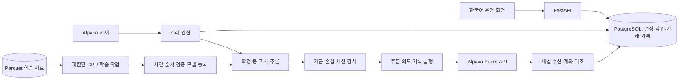

# 24시간 자동 주식 매매 시스템 개발 계획

최신 단계(2026-10-09, ADR-0048~0050): SPY 공식 배당 보완과 원시 현금 회계, ETF 주문 없는 목표비중 계획·PostgreSQL 계획 동결·재시작 검증을 완료했습니다. 전체195개 검사 통과. 공급자 조정 가격에서 배당 두 건 누락을 확인했으며 교정한 세전 원시 재현 CAGR14.0622%/DD33.7652%입니다. 현재 운영 배포/주문 전환은 없고, 25단계에 완료·미완료 경계를 기록했습니다. [상세 결과](docs/ETF_EXECUTION_0048_0050.md).

현재 기준(2026-10-08, ADR-0045~0047): 사용자가 서버 스펙·Python 외 제약을 해제했습니다. 아래 초기 고정 종목/IEX/매매·위험 조건은 기존 엔진의 계약과 설계 이력이며 새 ETF 연구의 필수 제약이 아닙니다. [ETF 실제 비교](docs/ETF_STRATEGY_0045_0047.md)를 완료했고 수익 중심 개발 기준은 SPY 무차입 장기 보유, 낙폭 억제 대안은 분산 추세입니다. 새 ETF 주문 실행·원시 배당 회계·일봉 자동 증분은 후속 구현이며 현재 매수 보류/운영 위험 설정은 유지합니다. 24단계에 결과와 다음 구현 순서를 기록했습니다.

최신 상태(2026-10-08): ADR-0040~0044에서 여러 날 보유 필수 조건을 해제하고 승인 질문 없이 새 규칙3개 구현/24replay/원장감사를 완료했다. 모두 미채택·전체153테스트 통과·Paper$100,000/보유0/주문0·기존운영이미지 유지. [실제 전략 비교](docs/RESEARCH_0040_0044.md). 이전22단계의 대화 실행 보류는40에서대체했으며새일봉독립자료자동증분계약공백은남아있다.

작성일: 2026-10-03, 한국 시간 기준.
상태: 사용자 답변을 반영한 구현 기준. 아래 확정 결정이 초안의 잠정 제안보다 우선한다.

## 확정 결정 — 2026-10-03

- 운영 서버: Ubuntu 24.04.2 aarch64, 4코어, RAM 23GiB, 사용 가능한 디스크 약 184GiB, GPU 없음.
- 목표: 비용 반영 수익 개선. 높은 수익률을 사전에 보장하거나 거래 횟수를 늘리는 것을 수익 극대화로 간주하지 않는다. 검증 기간의 순수익을 낙폭·최소 표본 제약 하에서 비교하고 최종 테스트는 선택에 사용하지 않는다.
- 주문은 정규장에서만 한다. 서버·복구·감시는 상시 구동한다. 무료 IEX 조건에서 프리/애프터를 기본 전략에 섞지 않는다.
- 무료 Basic WebSocket 한도 30종목에 맞춰 거래 후보 28개와 시장 비교용 SPY/QQQ를 감시한다. 후보 목록은 초기 연구용이며 수익 우위를 입증한 목록은 아니다.
- 5분봉 자료로 판단하되 진입 검사는 15분 경계에서 한다. 30/60/120분 label의 공유 LightGBM·XGBoost CPU·CatBoost CPU와 균등 앙상블을 검증해 하나의 운용 후보와 보유 기간을 선택한다. 종목별 개별 모델 30개를 학습하지 않는다. 변경 이유는 [ADR-0003](docs/DECISIONS.md)에 기록한다.
- 주식 매수 후 매도, 정수 수량, 당일 청산으로 시작한다. 옵션·가상자산은 주식 요청 범위에 포함하지 않는다. 공매도와 시간외는 우위가 입증되기 전 자동 활성화하지 않는다.
- 기본 운용 예산 상한은 USD 100,000과 실제 계좌 시작 equity 중 작은 값이다. 명시적 `CAPITAL_LIMIT`로 축소할 수 있으며 전략 자금과 Paper 전체 구매력을 구분한다. 이미 보유한 수동 포지션이 있으면 자동 진입을 보류한다.
- 초기 한도: 거래당 예상 손실 0.25%, 일일 손실 1.5%, 총 노출 60%, 종목 노출 15%, 동시 보유 4개, 전략 최대 낙폭 10%. 일일 한도 초과 시 진입 중단·진입 취소·전략 포지션 청산. 최대 낙폭 중단은 수동 재개 전 유지한다.
- 손절은 변동성 기반(ATR), 익절은 손절 거리의 2배를 초기 계약으로 둔다. 해당 계약과 시간 청산을 반영하는 포트폴리오 백테스트로 신호 문턱을 선택한다.
- 별도 대시보드는 첫 버전에 생략한다. localhost에서 접근하는 인증된 상태·제어 API와 Discord 웹훅 알림을 제공한다.
- 웹훅은 로컬 비밀 파일에 저장하고 Git·Docker 이미지·로그에서 제외한다. 사용자 키도 같은 방식으로 주입한다.
- 학습 작업은 최대 2코어·8GiB, 엔진과 API는 별도 자원 한도를 사용한다. 훈련 중에도 거래 엔진이 동작할 수 있게 한다.
- 기존 프로젝트가 없으므로 삭제·이전 서비스 종료·계좌 초기화 작업은 없다.
- 필수 요구 질문은 해결되었다. 키 제공 없이 구현·모의 검증·ARM 빌드를 완료하고 실제 계좌 연결 검증은 별도 상태로 보고한다.
- 전체 스캔은 추후 저비용 일봉 필터 → 제한된 실시간 종목 → 공유 모델 평가 구조로 확장할 수 있다. 후보 선정 시점 기록과 생존 편향 처리를 먼저 갖춰야 한다.
- [확인한 Basic 한도](https://docs.alpaca.markets/us/docs/about-market-data-api): 실시간 IEX, WebSocket 30종목, 과거 API 200회/분. 실제 인증 후 응답 권한을 우선한다.

## 1. 확정된 요구사항과 현재 상태

- 운영 서버는 aarch64 CPU이며 GPU가 없다.
- FastAPI, Python 3.14.2, Docker, Alpaca를 사용한다.
- 기존 구현을 재사용하지 않고 새로 설계한다.
- 계획 단계에서 불명확한 요구사항을 질문하고 답변을 반영한 뒤 개발한다.
- 사용자에게 Paper 설정이나 Paper/Live 선택을 요구하지 않는다.
- 현재 작업 경로 `/home/ubuntu/stock-trader`는 비어 있으며 Git 저장소도 없다. 이 경로에 삭제할 기존 파일은 없다. 다른 경로의 기존 서비스·데이터·Docker 볼륨은 위치가 확인되기 전까지 변경하지 않는다.
- 현재 개발 환경은 aarch64, 시스템 Python 3.12.3, Docker 28.3.2이다. 구현·검증은 별도의 Python 3.14.2 컨테이너에서 수행한다. 이 정보가 실제 운영 서버의 사양을 대신하지는 않는다.

## 2. 사용자 답변을 반영한 운영 기준

| 항목 | 확정 내용 | 이유 |
|---|---|---|
| 주문 시간 | 서버는 상시 가동, 주문은 미국 정규장 | 현재 데이터 권한과 정규장 보호 주문 계약에 맞춤 |
| 매매 방식 | 5분봉 피처·15분 진입 판단, 롱 전용·당일 청산 | 공유 모델의 30/60/120분 예측을 비용 반영 평가로 선택 |
| 거래 종목 | 거래 후보 28개와 시장 비교용 2개 | 무료 IEX WebSocket 30종목 한도에 맞춤 |
| 시세 권한 | 무료 IEX 고정 | 학습과 운영 피드 일관성을 유지 |
| 운영 서버 | ARM64 4코어·23GiB·184GiB 여유·Ubuntu 24.04.2 | 학습 2코어·8GiB와 상시 엔진 자원을 분리 |
| 자금·손실 한도 | 예산 상한 USD 100,000, 일일 손실 1.5% | 실제 계좌와 사용자 변경 가능한 상한을 함께 적용 |
| 운영 UI | localhost 인증 API, SSH 터널 | 외부 공개 대시보드가 필수 요구가 아님 |
| 알림 | 사용자가 지정한 Discord 웹훅 | 비밀 파일 주입과 영속 재시도 대기열 사용 |
| 기존 시스템 | 없음 | 삭제나 계좌 초기화를 수행하지 않음 |

LightGBM은 첫 구현의 CPU 기준 모델이었다. 수익 우위를 비교로 입증한 선택은 아니므로 ADR-0003에서 후보를 확대했다. 실제 IEX 자료에 대한 채택은 동일 기간의 비용 반영 검증과 최종 미사용 테스트 결과로 결정한다. 설치·운영 결과는 [검증 기록](docs/VERIFICATION.md)과 [의사결정 기록](docs/DECISIONS.md)에 누적한다.

## 3. 시스템 구성과 기술 선택

| 구성 | 기술/역할 | 선택 이유 |
|---|---|---|
| API·운영 화면 | FastAPI, Pydantic v2, Uvicorn | 설정 검증, 상태 조회, 운영 제어를 제공 |
| 거래 엔진 | 별도 Python 프로세스, asyncio | 웹 서버 재시작·다중 worker가 주문 루프를 복제하지 않게 분리 |
| Alpaca 연결 | HTTPX REST + websockets, 전용 어댑터 | 비동기 호출, 타임아웃·재시도·응답 검증을 통제하고 SDK 의존성을 줄임 |
| 영속 저장 | PostgreSQL, Psycopg 3, 버전별 SQL 마이그레이션 | 주문 의도, 거래 기록, 작업 상태, 동시 실행 제어를 트랜잭션으로 저장 |
| 시세·학습 자료 | NumPy/Pandas, Parquet, PyArrow | CPU 기반 전처리와 날짜·종목별 자료 보관 |
| 추론·학습 | LightGBM, XGBoost CPU hist, CatBoost CPU, 균등 앙상블 | 동일 수치 피처·기간·비용으로 비교하고 실측 결과에 따라 선택 |
| 웹 UI | 필요 시 Jinja2 기반 화면, 가벼운 브라우저 코드 | 별도 프런트엔드 서버 없이 운영 상태 확인 |
| 실행·배포 | Docker Compose, linux/arm64 | 단일 ARM 서버에서 서비스·영속 볼륨을 재현 가능하게 실행 |
| 검증 | pytest, HTTP/스트림 모의 서버, Ruff | 돈·주문·복구 경계의 실제 실패 상황을 검증 |

- 상시 컨테이너는 API, 거래 엔진, PostgreSQL을 기본으로 한다.
- 학습은 별도 컨테이너 작업으로 실행하고 CPU·메모리 사용량을 제한한다.
- 프록시·TLS는 사용자 접속 방식에 맞춰 추가한다. Redis, Celery, Kubernetes는 현재 규모에서 필수로 두지 않는다.
- Python은 일반 CPython 3.14.2로 고정한다. Free-threaded 빌드나 GPU 패키지를 전제로 하지 않는다.
- 모든 직접·간접 의존성을 잠그고 ARM 컨테이너에서 확인한다. PyPI에 wheel이 있다는 사실만으로 전체 조합의 호환성을 통과 처리하지 않는다.
- Python 3.14.2 ARM 베이스 이미지 존재·런타임 버전을 실제로 확인한다. 이미지가 제공되지 않으면 공식 CPython 소스로 동일 버전을 빌드한다. 더 낮은 Python 버전으로 조용히 바꾸지 않는다.



## 4. Alpaca 연결 계약

- Paper Trading REST 주소를 프로그램 내부에서 `https://paper-api.alpaca.markets`로 고정하고 사용자 설정에서 제거한다.
- 주문 스트림도 Paper 주소를 사용한다. 키 ID·Secret만 공급하면 연결 검증을 진행한다.
- 인증 실패 시 시작 오류를 표시한다. Live API로 자동 재연결하지 않는다.
- 키는 서버의 비밀 파일/환경 주입으로 받는다. 채팅, 소스코드, 로그, 상태 API에 노출하지 않는다.
- 시작 시 계좌 상태, 거래 제한, 자산 거래 가능 여부, 시세 권한, 기존 주문·포지션을 확인한다.
- Market Data API는 Trading API와 별도 연결로 취급한다. Paper 계좌가 있다고 모든 실시간 피드 접근을 가정하지 않는다.
- IEX·SIP·overnight·BOATS는 명시적으로 구분한다. 권한 문제로 피드를 바꿀 경우 데이터·모델의 호환성을 검사하고 기록한다.
- API 제한은 응답 헤더와 429를 반영한다. 구독 종목·연결 수는 권한에 맞춘다.
- 주문 쓰기 요청은 일반 조회처럼 자동 재시도하지 않는다. 응답이 불명확한 주문은 동일 client_order_id로 먼저 조회한다.

## 5. 24시간 운영과 거래 세션

- 서버 가동과 실제 체결 가능한 시간을 구분한다.
- 미국 거래일·휴장·조기 폐장은 Alpaca 캘린더/시계와 해당 세션 정책으로 판단한다. 한국 시각에 고정된 예약표를 사용하지 않는다.
- 저장은 UTC, 세션 계산은 America/New_York, 운영 화면은 Asia/Seoul과 필요 시 미국 시간을 함께 표시한다.
- 상태는 초기화 → 계좌 대조 → 자료 준비 → 대기 → 거래 가능 → 종료 처리로 진행한다. 문제가 있으면 신규 진입 중단 상태로 전환한다.
- 거래 전: 계좌·미체결 주문 대조, 데이터 빈 구간 보충, 모델·설정 버전 확인.
- 거래 중: 확정 봉 판단, 실시간 보호·청산 확인, 주문/포지션 대조, 연결 복구.
- 거래 후: 당일 기록 확정, 성과·실행 비용 계산, 보고서, 자료 정리.
- 비거래 시간: 다음 거래일 준비, 검증을 거친 학습 작업, 보관 정책 실행, 상태 감시.
- 작업 실행 시간과 완료 상태를 DB에 기록한다. 재시작으로 학습·보고서·청산 작업이 반복되지 않게 한다.
- 서버 재부팅 후 Docker와 서비스가 자동 시작되도록 운영 안내를 제공한다. 단일 서버 장애를 자동 재시작만으로 완전한 무중단 운영이라고 표현하지 않는다.
- 외부 서버 장애 감시가 필요하면 사용자 채널·운영 환경에 맞춰 추가한다.

### 정규장·당일 청산 선택 시 제안

- 첫 버전의 진입 판단은 확정된 5분봉 피처를 사용해 15분 경계에서 실행한다. 손실 감시·주문 확인은 5초 주기로 계속한다.
- 실제 장 종료 30분 전부터 신규 진입을 중단한다.
- 종료 10분 전부터 전략 소유 포지션의 청산을 시도하고 체결 완료까지 확인한다.
- 조기 폐장에도 동일한 상대 시간을 사용한다.
- 마감까지 미청산된 잔여 포지션은 명시적으로 기록하고 경고한다. 닫힌 장에 주문이 체결됐다고 간주하지 않는다.

시간외를 선택하면 제한가·세션별 체결 정책을 별도로 구현한다. 정규장 브래킷 주문을 시간외 보호 수단으로 그대로 사용하지 않는다.

## 6. 시장 자료 처리

- 과거 자료 수집은 페이지 순회, 요청 제한, 중단 후 재개를 지원한다.
- 실시간 연결은 필요한 봉·호가만 구독한다. 모든 tick을 저장하는 구조로 시작하지 않는다.
- 종목·피드·시간·조정 방식·수집 버전을 기록하고 중복 자료를 제거한다.
- 늦게 도착한 수정 봉과 결측 봉을 구분한다. 확정 대기 정책을 두고 학습 시에도 동일한 가용 시점을 재현한다.
- 재연결 시 빠진 구간을 REST로 보충하고 충분한 lookback이 복구된 뒤 진입 판단을 재개한다.
- 오래된 호가, crossed quote, 비정상 가격, insufficient lookback, 데이터 누락은 해당 종목의 신규 진입을 차단한다.
- 데이터가 오지 않으면 가격을 임의 보간해 주문하지 않는다.
- 거래량 피처는 피드별로 계산한다. SIP 학습 모델에 IEX 거래량을 그대로 입력하지 않는다.
- 분할·배당·거래 중단·심볼 변경을 고려한다. 주문 가격은 현재 실제 가격 기준, 연구용 조정 가격은 별도 메타데이터로 관리한다.
- 과거 피처에 미래에 확정된 기업행동 정보가 섞이지 않도록 처리한다.
- Parquet는 날짜/피드 기준으로 나누고 임시 파일 생성 후 원자적으로 교체한다. 보관 기간과 압축 정책은 디스크 용량에 맞춰 결정한다.

## 7. 매수·매도 판단과 자금 관리

### 판단 흐름

1. 확정 봉과 필요한 과거 자료가 존재하는지 확인한다.
2. 피처·모델 버전이 맞는지 확인하고 예상 수익/상승 확률을 계산한다.
3. 예상 이익을 스프레드·슬리피지·비용 가정과 비교한다.
4. 세션·계좌·손실·노출 한도를 확인한다.
5. 주문 수량과 진입·손절·익절 가격을 산출한다.
6. 주문 의도를 DB에 저장하고 거래 엔진이 발행한다.
7. 체결 수량과 보호 상태를 확인한 뒤 포지션 상태를 갱신한다.

### 매도 기준

- 보호 손절, 목표 익절, 최대 보유 시간, 신호 약화, 당일 청산 정책을 분리한다.
- 손절과 계좌 위험 제한이 모델 신호보다 우선한다.
- 단순히 매수 점수가 낮아졌다는 이유만으로 매수/매도를 반복하지 않도록 진입·청산 문턱과 재진입 대기 시간을 분리한다.
- 롱 전용 선택 시 보유 수량을 넘는 매도를 금지한다. 공매도·마진을 자동 활성화하지 않는다.
- 첫 버전은 정수 주식을 기본 제안으로 삼아 수량·브래킷 제약을 단순화한다. 예산상 소수점 주식이 필요하면 주문 설계를 별도로 확정한다.

### 확정해야 할 위험 설정

| 설정 | 구현 원칙 |
|---|---|
| 운용 예산 | 사용자 지정 예산과 실제 사용 가능한 자금 중 작은 값을 기준으로 함 |
| 거래당 위험 | 손절까지의 예상 손실로 수량을 산정하며 주문 비용도 반영 |
| 종목별 비중 | 개별 종목에 자금이 과도하게 집중되지 않도록 제한 |
| 동시 보유 수 | 체결 포지션과 대기 진입을 함께 고려 |
| 총 노출 | 포지션 평가액과 미체결 주문의 예약 자금을 함께 고려 |
| 일일 손실 한도 | 거래일 시작 평가액 대비 실현·미실현 손익 및 비용으로 계산 |
| 전략 최대 낙폭 | 전략 평가액 고점 대비 손실로 계산하며 DB에 기준값 보관 |
| 스프레드·유동성 | 신규 진입 허용 범위를 사용자 시세 피드에 맞춰 설정 |

- 입출금·Paper 계좌 변경이 손익으로 잘못 잡히지 않도록 검출한다.
- 운용 예산은 실제 계좌 전체 잔고와 분리한다. 다른 수동 포지션이 있으면 전략 소유권과 계좌 자금 점유를 함께 대조한다.
- 일일 손실 중단은 신규 매수 중단과 미체결 진입 취소 후 전략 포지션 전량 청산을 수행한다. 보호 주문 취소가 확인되기 전에는 중복 매도하지 않는다. 정규장 밖에서는 청산 요청을 유지하고 다음 정규장에서 처리한다.
- 중단 사유·시점을 영속 저장하여 재시작으로 손실 중단이 해제되지 않게 한다.
- 일일 제한은 다음 거래일 시작 시 지정 정책으로만 갱신한다. 최대 낙폭·수동 비상 중지는 임의로 해제하지 않는다.

## 8. 주문 발행·부분 체결·복구

- 계좌별로 주문을 발행하는 엔진을 하나로 제한한다. DB 잠금을 잃거나 DB 상태를 확인할 수 없으면 새 주문 발행을 중단한다.
- 신호 키는 전략 버전·종목·확정 봉·행동을 기준으로 만들고 DB unique 제약을 적용한다.
- Alpaca client_order_id는 이 신호 키에서 생성한다. timeout 뒤 새 ID로 같은 주문을 다시 보내지 않는다.
- 외부 API와 DB를 하나의 원자적 트랜잭션처럼 취급하지 않는다. 중복 방지와 사후 대조로 일관성을 회복한다.
- 주문 상태는 의도 저장, 제출 중, 결과 불명, 접수, 부분 체결, 전량 체결, 취소 대기, 취소, 거절, 만료를 구분한다.
- 주문 이벤트는 중복·순서 역전을 견디고 누적 체결 수량이 잘못 감소하지 않도록 처리한다.
- 결과 불명 주문은 client_order_id 조회와 계좌·주문 대조가 끝날 때까지 해당 종목의 추가 주문을 차단한다.
- 취소 요청 성공을 취소 완료로 간주하지 않는다. 취소 중의 추가 체결을 반영한 뒤 남은 수량을 판단한다.
- 재시작·스트림 복구 시 열린 주문, 최근 체결, 실제 포지션을 먼저 대조한다. DB 불일치가 남으면 신규 진입을 중단한다.
- 수동 주문과 기존 시스템 포지션은 자동으로 전략 포지션에 편입하거나 청산하지 않는다. 소유권 정책을 확정하고 화면에 분리 표시한다.
- 브래킷은 정규장·정수 수량의 조건을 확인해 적용한다. 전량 진입 체결 전에 보호 leg가 활성화되지 않는 구간을 별도로 추적한다.
- 부분 체결 후 진입 만료 시 남은 진입의 취소가 확인된 다음, 실제 수량에 맞는 보호 또는 청산을 수행한다.
- 청산 시 기존 보호 매도 주문의 상태와 예약 수량을 먼저 확인한다. 중복 매도로 의도치 않은 공매도가 생기지 않게 한다.
- 브래킷 양쪽 체결과 같은 예외에도 실제 포지션을 기준으로 수습한다. 비상 동작의 실패 역시 기록·알림 대상이다.

## 9. 모델·학습 설계

- LightGBM·XGBoost CPU hist·CatBoost CPU·동일 horizon의 세 모델 균등 평균 앙상블을 비교한다. 앙상블의 우위를 가정하거나 무조건 운용하지 않는다. 초기 LightGBM 단독 판단과 대체 이유는 ADR-0001·0003에 남긴다.
- 3 horizon × 4 모델 방식 × 3 진입 문턱, 총 36개 후보를 비교한다. 각 모델은 고정된 200회 boosting·최대 2스레드로 순차 학습한다. 자원·진행 상태·native 저장 계약은 ADR-0005, CPU 전용 XGBoost 패키지는 ADR-0006을 따른다. 자유 가중치 튜닝과 stacking은 이번 범위에 포함하지 않는다.
- 서버 사양에 맞춰 스레드 수, 학습 자료 크기, 튜닝 횟수를 제한한다. 거래 엔진의 CPU·메모리를 학습에 모두 사용하지 않는다.
- 피처 예: 여러 구간 수익률, 변동성/ATR, 이동 평균 거리, 세션 VWAP 거리, 상대 거래량, 시장 대비 강도, 시간대, 가능한 경우 호가 스프레드.
- 종목 간 단위를 정규화하고 미래 자료를 사용하지 않는다. 학습 전처리와 운영 전처리를 같은 코드로 실행한다.
- 예측 대상은 다음 6/12/24개 5분봉(30/60/120분)의 수익률이다. 신호 봉 이후의 다음 봉 시가를 진입 기준으로 삼고 같은 거래일 안에서만 label을 만든다. 모델 점수에서 비용을 검사하며 비용 반영 포트폴리오 성과로 후보를 선택한다.
- 확률 출력을 쓸 경우 시간 순서를 유지한 검증 구간으로 보정한다. 임의로 0.5를 매수 문턱으로 정하지 않는다.
- 성과 비교용 단순 규칙 전략과 무거래/벤치마크를 먼저 만든다. 모델이 없을 때 규칙 전략을 조용히 대신 실행하지 않는다.
- 학습 → 검증 → 테스트를 날짜 순서로 분리하고, label 기간이 겹치는 경계에는 purge/embargo를 적용한다.
- walk-forward 검증으로 여러 시장 구간을 확인한다. 무작위 train/test 분할은 사용하지 않는다.
- 문턱·피처·튜닝 결과는 검증 구간에서만 선택한다. 최종 테스트 구간을 보고 반복 튜닝하지 않는다.
- 현재 우량 종목만으로 과거 성과를 평가할 경우 생존 편향을 명시한다. 전체 자동 선별을 선택하면 거래 시점에 알 수 있었던 종목 선정 자료를 저장한다.
- 모델은 LightGBM native text·XGBoost UBJSON·CatBoost CBM과 JSON 메타데이터로 저장한다. 메타데이터에는 모델 종류·구성원·가중치, 학습 범위, 피드, 피처 스키마, 전략 설정, 평가 결과, 파일별 체크섬을 포함한다. 설치 버전은 잠금 파일로 고정한다.
- 초기 자료 확보·학습·검증이 완료되지 않으면 신규 진입을 허용하지 않는다.
- 정기 재학습은 우선 주간 작업을 제안한다. 자료 부족·드리프트·성능 저하 여부를 확인하고 검증을 통과한 후보만 적용한다.
- 교체는 열린 주문·포지션의 기존 전략 계약을 유지하며 새 신호부터 적용한다. 포지션의 손절 규칙을 모델 교체로 갑자기 바꾸지 않는다.
- 실패 후보는 운영 모델을 덮어쓰지 않는다. 기존 모델도 유효하지 않으면 신규 진입을 중단하고 보호·청산을 계속한다.

## 10. 백테스트와 성과 검증

- 운영과 같은 신호·위험 관리 규칙을 사용하고 체결 엔진만 분리한다.
- 시간 청산은 예정 시각의 봉 시가로 처리하는 `timed-open-v2` 계약을 사용한다. 초기 평가의 5분 지연은 ADR-0011·0013에 기록하고 별도 연구에서 비교했다. 초기 재현은 명시적 legacy 계약을 사용한다.
- 확정 봉 이후에 낼 수 있는 주문을 같은 봉의 유리한 가격으로 체결 처리하지 않는다.
- 지정가 미체결, 부분 체결, 스프레드, 슬리피지, 비용, 자금 점유를 반영한다.
- 같은 봉에서 손절과 익절을 모두 건드리면 더 세밀한 자료를 사용하거나 보수적인 순서 가정을 명시한다.
- 갭으로 손절가를 건너뛴 경우 손절가 체결을 보장하지 않는다.
- 성과는 순손익, 최대 낙폭, 위험 조정 수익, 거래 횟수, 회전율, 평균 보유 시간, 비용 민감도, 기간·종목별 분포를 함께 확인한다.
- 수익률 하나만으로 모델을 채택하지 않는다. 최소 표본, 위험 한도, 여러 기간의 안정성, 기준 전략과의 비교를 함께 평가한다.
- 측정하지 않은 목표 수익률을 약속하지 않는다. 채택 계약은 후보 성과를 확인하기 전에 고정하고 모든 후보에 동일하게 적용한다. 첫 구현의 초기 수치와 한계는 ADR-0009에 명시하며 이번 비교 중 변경하지 않는다.
- Paper 성과에는 실제 시장 충격·대기열·지연 슬리피지 등을 완전히 재현하지 못하는 한계가 있으므로 실행 비용을 별도로 분석한다.

## 11. 저장 구조·운영 제어·화면

### 주요 저장 항목

- 버전별 전략 설정, 종목 목록/선정 기록, 거래일과 세션 상태.
- 주문 의도, Alpaca 주문/leg, 체결 이벤트, 전략별 포지션 원장.
- 계좌 스냅샷, 예약 자금, 일일 기준 평가액, 위험 중단 사유.
- 모델 버전, 피처 스키마, 자료 manifest, 학습/검증 작업과 결과.
- API 제어 요청, 실행 상태, 감사 기록, 알림 발송/재시도 이력.

### 운영 API와 화면 제안

- 계좌·운용 예산·당일 실현/미실현 손익·노출·포지션·주문 조회.
- 현재 거래일·다음 개장/폐장·사용 시세 피드·자료 최신 시각 표시.
- 추론 모델·검증 결과·신호·매수/매도/보류 이유 조회.
- 연결 상태·마지막 대조 시각·학습 상태·자원 사용량·장애 기록 조회.
- 시작/신규 진입 중지/재개/비상 청산을 별도 제어로 제공한다. API가 직접 주문하지 않고 영속 제어 요청을 엔진이 처리한다.
- 설정 변경은 스키마·범위·버전을 검증한다. 거래 중 변경 적용 시점과 기존 포지션 영향을 기록한다.
- liveness와 readiness를 구분하고 HTTP 서버 응답만으로 거래가 정상이라고 표시하지 않는다.
- 일반 조회와 관리 권한을 구분한다. 상태 변경 요청은 인증·CSRF 정책에 따라 보호한다.
- 외부 접속 선택 시 HTTPS, 로그인/세션, 접근 제한을 구현한다. DB 포트는 외부에 공개하지 않는다.

### 알림 정책

- 주문 거절, 오래 지속되는 결과 불명 주문, 시세/주문 스트림 장애, 위험 중단, 미청산 잔여 포지션, 모델 교체 실패 등을 알린다.
- 정상 대기 상태를 반복 발송하지 않고 장애 종류별 중복 억제와 복구 알림을 둔다.
- 일일 보고서는 확정된 거래일 기준으로 작성한다. Telegram 등 외부 발송은 사용자가 지정한 채널에만 연결한다.

## 12. 배포·자원·보관

- ARM64 컨테이너에서 Python 버전·의존성·모델 추론을 확인하고 배포한다.
- 비 root 사용자, 서비스별 자원 한도, 정상 종료 신호 처리, 재시작 정책, 로그 회전을 구성한다.
- PostgreSQL·시세·모델·보고서는 별도 영속 볼륨에 보관한다.
- DB 백업과 복구 절차를 만들고 실제 복원 검증을 수행한다. 백업 위치·기간은 디스크와 외부 저장소 유무로 정한다.
- 같은 서비스가 구버전과 신버전에서 동시에 주문하지 않도록 전환 전 주문 발행 프로세스를 확인한다.
- 코드 초기화는 계좌 초기화·미체결 주문 취소·Docker 볼륨 삭제와 구분한다. 이전 서비스가 발견되면 전환 계획에 범위를 반영한다.
- 롤백 시 이미 발행된 주문을 잊지 않도록 DB·주문 계약과 호환되는 이전 버전만 사용한다.
- 디스크 부족·DB 장애·시세 장애·시계 불일치가 생기면 신규 진입을 중단하고 가능한 보호·조회·기록을 유지한다.

## 13. 구현 순서와 단계별 완료 기준

| 단계 | 구현 내용 | 완료 기준 |
|---|---|---|
| 0. 요구 확정 | 질문 답변 반영, 위험·세션·종목·운영 정책 확정, 기존 시스템 위치 확인 | 문서에 필수 미정 항목이 없고 교체 범위가 분명함 |
| 1. 실행 기반 | 프로젝트 구조, Python 3.14.2 ARM 이미지, 잠금 파일, Compose, DB 마이그레이션, 기본 API | 빈 환경에서 설치·기동하고 런타임 버전/아키텍처 확인, readiness 정상 |
| 2. Alpaca·자료 | Paper 고정 연결, 인증/권한 확인, 캘린더, 과거 수집, 스트림, gap 복구 | 모의 응답과 테스트 스트림으로 인증·429·disconnect·중복 자료 처리 검증 |
| 3. 주문·위험 | 주문 원장, idempotency, 자금 예약, 손실 중단, 부분 체결, 보호·청산, 재시작 대조 | 결과 불명·취소 경쟁·부분 체결·DB 장애·다중 엔진 상황에서 중복/과매도 방지 검증 |
| 4. 연구·학습 | 피처/label, 기준 전략, 백테스트, walk-forward, 모델 등록, 제한 학습 작업 | 미래 정보 누수 검사, 비용 반영 성과 보고서, 재현 가능한 모델 아티팩트 |
| 5. 자동 매매 | 모델 신호와 주문 엔진 결합, 세션/마감 처리, 모델 교체 정책 | 시뮬레이션 거래일 전체를 재현하고 위험·청산·재시작 계약 검증 |
| 6. 운영 기능 | 사용자 선택 UI, 제어 API, 알림, 감사 기록, 백업/복원 | 인증된 운영 제어, 중복 알림 억제, 상태 표시와 복원 검증 |
| 7. Paper 연동 검증 | 사용자 서버의 비밀 주입, 실제 권한/계좌 대조, 관찰 후 자동 주문 | 실제 접수/체결/취소/복구를 확인하고 모의 테스트와 실제 검증 결과를 구분해 기록 |
| 8. 상시 운영 검증 | 재부팅·재연결·로그 회전·학습 자원·여러 세션 점검 | 연속 운영 결과, 잔여 결함, 자원 사용량, 성과 보고서와 운영 설명서 제공 |

개발의 완료와 전략 성과 검증의 완료는 구분한다. 실제 거래일을 필요로 하는 관찰 기간은 소프트웨어 테스트 통과로 대체하지 않는다. 초기 제안은 최소 20거래일의 Paper 관찰이며, 표본 거래 수와 시장 구간에 따라 추가 검증 여부를 정한다.

### 반드시 검증할 실패 상황

- Alpaca가 주문을 접수했지만 클라이언트는 timeout을 받은 뒤 엔진이 재시작하는 상황.
- 중복·역순 체결 이벤트와 부분 체결 직후 취소/청산 요청이 겹치는 상황.
- 장 종료/조기 폐장 직전의 신호와 미국 DST 전환.
- 데이터 연결 복구 후 과거 봉이 한꺼번에 들어오는 상황.
- 같은 계좌에 엔진 두 개가 켜지는 상황과 DB 잠금 연결이 끊기는 상황.
- 손실 한도 도달 후 프로세스 재시작, 수동 포지션과 전략 포지션 혼재.
- 모델 스키마 불일치·학습 실패·디스크 부족·DB 장애.
- 서버 재부팅 후 열린 주문과 실제 포지션을 확인하고 진입을 재개하는 상황.

키·시장 개장·실제 Paper 계좌가 필요한 검증은 해당 조건이 갖춰져야 완료 처리한다. 모의 서버 통과만으로 실제 Alpaca 연동 완료라고 보고하지 않는다.

## 14. 예정 프로젝트 구조

```text
stock-trader/
  DEVELOPMENT_PLAN.md
  README.md
  pyproject.toml
  uv.lock
  Dockerfile
  compose.yaml
  .env.example
  src/stock_trader/
    api/              # 조회·운영 제어·선택 UI
    config/           # 설정 스키마·버전
    broker/           # Alpaca REST·주문 스트림
    market_data/      # 자료 수집·정리·복구·캘린더
    engine/           # 단일 주문 엔진·작업 조정
    execution/        # 주문 상태·부분 체결·대조·청산
    risk/             # 예산·노출·손실 제한
    strategy/         # 피처·신호·매도 정책
    research/         # 백테스트·시간 순서 평가
    models/           # 학습·아티팩트·교체
    persistence/      # DB·자료 저장·마이그레이션
    monitoring/       # 건강 상태·로그·선택 알림
  tests/
  docs/               # 운영·복구·검증 결과
```

## 15. 확인한 공식 자료

- [Python 3.14.2 릴리스](https://www.python.org/downloads/release/python-3142/): 요청한 버전의 공식 릴리스 정보.
- [Alpaca Paper Trading](https://docs.alpaca.markets/us/docs/paper-trading): Paper 키와 API endpoint, 시뮬레이션 한계, 부분 체결 가정.
- [Alpaca 주문 문서](https://docs.alpaca.markets/us/docs/orders-at-alpaca): client_order_id, 주문 상태, 시간외 주문, 브래킷 활성화·제약.
- [Alpaca Market Data FAQ](https://docs.alpaca.markets/us/docs/market-data-faq): IEX/SIP 차이와 실시간·과거 권한.
- [Alpaca 실시간 주식 자료](https://docs.alpaca.markets/us/v1.1/docs/real-time-stock-pricing-data): 피드별 WebSocket.
- [Alpaca 24/5 안내](https://alpaca.markets/learn/how-to-trade-us-stocks-24_5-overnight-with-python-and-alpaca): 세션과 overnight/BOATS 자료 사용.
- [FastAPI 패키지 정보](https://pypi.org/project/fastapi/): Python 3.14 지원 분류. 실제 의존성 조합 검증은 별도 필요.
- [LightGBM 패키지 정보](https://pypi.org/project/lightgbm/): Python 지원 분류 및 Linux aarch64 배포 파일. 실제 설치·학습·추론 검증은 별도 필요.

## 16. 2026-10-03 후속 연구·반복 탈락 운영 변경

- ADR-0014 비용 연구 완료: 고정 원장 72개와 120분 후보 96개 비용 비교, 추가 학습 0회. 비용 5·10·20·30bps 모두 검증 통과 0개. [상세 결과](docs/RESEARCH_0014.md).
- ADR-0015: 자동 작업 연속 검증 탈락 3회/최종 테스트 실패 1회면 같은 계약 학습 보류. 오류는 성과 탈락과 분리한다. 자료·엔진·API·포지션 관리는 계속한다. 정책·이전 실패 평가 마지막 날짜·명시적 재개 기록을 DB에 저장한다.
- 수정한 가설/평가 계획을 문서화한 관리 명령으로 재개하며, 이전 최종 테스트를 재사용할 수 없다. [운영 안내](docs/TRAINING_POLICY.md).
- 현재 전략의 다음 모델 실험은 과거 완료 세션의 추세·변동성 정보 보강을 한 차례 비교하는 것이다. 이번 단계에서는 비용 연구와 운영 정책만 구현·검증했다. 후속 실험의 피처/표본/모델/평가 범위를 실행 전에 별도 등록한다.
- 운영 비용 20bps, 주문 시간·위험 한도·검증 문턱·신규 매수 보류는 유지한다. 수익성은 입증되지 않았다.

## 17. 2026-10-04 연속 진행과 여러 날 보유 연구

사용자가 단계 사이에 멈추지 않고 계속 진행하도록 위임했으며, 여러 날 보유 여부도 기존 방식에 연연하지 않고 판단하도록 요청했다. 완료 세션 context 비교 → 공급자 실제 5분봉 비교 → 진입 가능 표본 학습 비교를 완료했다. 실제 자료는 늘었지만 모두 기존 채택 기준을 통과하지 못했다. 결과를 보면서 비용/위험/최소 거래 수를 낮추지 않는다.

다음 우선 가설은 완료 일봉에서 신호를 만들고 다음 정규장에 진입하여 2·5·10거래일 보유하는 전략이다(ADR-0020·0021). 세 모델/균등 앙상블, 27회 학습/36후보, 같은 3개 expanding fold와 위험 한도, 미래 label purge로 연구한다. 전날 확정 정보·raw 정수 수량·실제 주식 분할·야간 gap·종목 공통 자본을 반영한다. 최적/수익성은 측정 전 가설이다.

연구 도중 2025-03-10의 장중 IEX 자료 전체 공백을 발견했고 재조회도 0행이었다. 그 날짜를 지나는 경로는 검증 불가능으로 제외하며 미래 자료 가용성 제한을 실전 매수 필터로 주장하지 않는다. 독립 최종 테스트 2026-06-16 이후는 이번 연구에서 사용하지 않는다.

정규장 시세 관찰 서비스를 별도 배포했다. 모델이 없더라도 실제 봉/호가 품질을 24시간 대기·정규장 수집하며, 지금은 휴장이므로 실시간 표본을 기다린다. [운영 안내](docs/MARKET_OBSERVATION.md).

후속 단계는 연구 결과에 따른 후보 하나 고정 → 같은 보유 기간의 일봉 기준 전략/비용 스트레스 → 독립 최종 평가 → 여러 날 포지션·분할·보호 주문·일손실 기준을 지원하는 운영 엔진 구현/검증 → 실제 Paper 관찰이다. 기준을 통과하지 못하면 해당 계약의 우위 미확인과 제한된 새 가설을 기록한다. 현재 당일 청산 엔진에 일봉 모델을 강제로 주입하지 않는다.

### 17단계의 실행 결과와 현재 분기

일봉/현재 가격 계약에서 XGB 2일과 단순 10일 추세가 개발 기준을 통과했다. 더 높은 사전 점수의 단순 규칙을 선택해 비용 1.5배 검증까지 통과했지만, 독립 최종 구간 2026-06-16~2026-10-01에서 32거래/-1.5905%로 탈락했다. 규칙과 모델 모두 운영 등록하지 않았다. 사용한 최종 구간은 DB 정책과 보고서에서 재사용을 차단한다(ADR-0026).

새 독립 자료/문서화한 새 가설이 필요하다. 현재 회귀/추세 계약의 자유 탐색을 반복하지 않는다. 운영은 24시간 시세 관찰·자료 갱신·API/연결/복구로 이어가며, 수익성 검증 전 신규 매수는 보류한다. [상세 실행 기록](docs/RESEARCH_0016_0026.md).

## 18. 사용자 제안에 따른 목표 도달 청산 비교(2026-10-04)

ADR-0027에서 최대 보유 기간을 제거하고 같은 진입/고정 익절·손절·위험 한도를 사용하는 연구를 구현했다. 기존 전략도 목표 도달 시 조기 청산했으며 새 가설은 시간 청산 제거다. 종료일의 열린 거래는 가짜 청산하지 않고 추정 비용 후 평가액/미실현 손익을 별도로 보고한다.

개발 평가 순수익 20bps +2.9426%→+3.5733%, 30bps +2.4028%→+3.3470%. 완료 거래 61→38, 잔존 2개, 최장 완료 66달력일. 기존 60완료 기준은 유지하므로 운영 승격하지 않는다. ADR-0028 연속 블록 민감도는 일부 조건에서 손실 범위가 남았으며 독립 검증을 대체하지 않는다.

기존 독립 실패 원장은 명시 비용 전에도 -1.3273%다. 시간 청산 합산 가격 손익은 양수였으므로 기간 고정만을 실패 주원인으로 확정하지 않는다. 새 방식의 개발 개선을 기록하고 새 독립 자료/완료 표본이 필요하다. 이미 소비된 최종 구간에서 새 전략을 평가하지 않았다. 연구 정책/신규 매수 보류·상시 관찰을 유지한다. [상세 보고서](docs/RESEARCH_0027_0028.md).


## 19. 2026-10-04 호출 보호·목표 도달 학습·예측 진단

ADR-0029에서 완료 자료 cache재사용과 공유 REST예산을 구현·운영 반영했다. 실제 일봉3/native630파일을 요청0회로 재사용했고 모든 서비스의 REST합산 간격0.4초/시세0.8초와429cooldown을 공유한다. 일반테스트/오프라인연구는 시장API를 호출하지 않는다.

ADR-0030의 실제 목표도달gross label로 LGBM/XGB/CatBoost9회 학습·앙상블포함12후보·65replay를 완료했다. 순수익양수6개지만 기존표본/PF/fold/단순기준초과 조건을 모두 만족하는 후보0개다. 같은개발구간 추가튜닝 대신 ADR-0031의 native/OOF재현·검열/낙관편향 진단을 완료했다. 완료label153거래일보유까지 반영했으나 독립 수익우위는 확인되지 않았다.

현재는 정책보호/24시간운영연결·정규장실시간관찰·주간증분수집을 유지한다. 소비최종종료2026-10-01 이후 새독립자료와 별도사전가설이 후속승인 조건이며 현재엔진에 장기보유모델을 강제등록하지 않는다. 연구/원인/제약은 [RESEARCH_0029_0031.md](docs/RESEARCH_0029_0031.md)에 기록했다.

## 20. 2026-10-07 실제 관찰 교정과 완료일 자동 품질 보고

ADR-0032에서10월5·6일 실제 자료의 요청 시작 시각 기준 future 오분류를 발견하고 수신 시각 기준 schema2로 교정했다. 작업 시간에 누적되던 관찰 간격도 시작 기준60초로 바꿨다. 원본 기록을 덮어쓰지 않고 반복 관측과 고유 봉을 분리 감사했다. 학습/전략 replay/시장자료 재요청은0회다.

ADR-0034에서 휴장 중 지난 뉴욕 날짜의 파일만 감사하여 원본·코드·SHA·품질 요약을 자동 저장하도록 구현했다. 캐시/변경원본거절/오류시관찰지속과 실제서비스의2세션complete를 확인했다. 전체137개 검증 통과 후 API/observer를 배포했고 기존 engine/trainer·연구 보류·위험/비용/승격 기준은 유지했다.

다음 단계는 다음 정규장 schema2 시각과 주기 확인 → 완료일 품질 보고 자동 누적 → 주간 증분 수집 확인 → 미사용 독립 자료와 사전 등록 가설 확보 시 제한된 연구 재개다. 현재 이틀의 품질 관찰을 수익성/거래 표본으로 간주하지 않는다. 기존 최종 구간 재사용이나 같은 후보의 자유 튜닝을 진행하지 않는다.

ADR-0033에서 서버 자동 운영과 에이전트 개발을 구분했다. 서버는 대화 종료 후 계속 운영하지만 이번 대화에서 에이전트 예약은 생성하지 않았다. 현재 사용자의 수동 학습/정책 해제는 필요 없다. [실제 관찰 결과](docs/RESEARCH_0032_0034.md), [자동 운영 안내](docs/AUTONOMOUS_OPERATION.md).

## 21. 2026-10-08 장중 교정 확인과 DB 복구 대조

ADR-0035에서 기존 주 DB PostgreSQL17.7과 REST 조정 보조 SQLite의역할을명시했다. 단일서버/짧은직렬화작업으로보조범위를제한하고멀티호스트확장시중앙제한기를별도평가한다. 기존DB/호출예산마이그레이션없음.

ADR-0036은실제390개schema2·11700호가의수신시각/age/state를재현하여불일치0·future0·시작간격중앙60.045초를확인했다. NY당일고정preview로보존하고자동감사계약을앞당기지않았다. 새학습/전략replay/자료재요청없음.

ADR-0037에서일관된export snapshot으로pg_dump/restore하여7테이블27행전체내용SHA/행수·보류정책일치,임시DB정리와SQLite backup사본integrity를확인했다. 로컬실제복구검증이며외부/예약백업도입이아니다. scripts/verify_storage.py와증거를보존했다.

다음은지난완료일자동확정보고→후속세션자료누적→주간증분수집점검이다. 연구재개는미사용독립자료와사전가설/실험계획이필요하다. 현재연구보류/매수보류·기존위험/비용/표본문턱을유지한다. [DB 안내](docs/DATABASE_ARCHITECTURE.md), [후속 결과](docs/RESEARCH_0035_0037.md).

## 22. 2026-10-08 추가 자료 조건과 문헌 전략 후보

사용자가 추가 자료가 필요한 다음 단계는 진행하지 않도록 지시했다. ADR-0038·0039에 따라 자료/운영 상태와 날짜 열 메타데이터를 읽고 원 연구·공식 문서를 조사했다. 시장 자료 수집·새 전략 구현·학습·백테스트·정책/운영 배포 변경은 하지 않는다.

후보 조사 순서는 대형주 단기 반등/낮은 회전율 → 중기 상대강도 → ETF 장기 추세/현금 → 잔차 모멘텀 → 페어다. 문헌과 우리 환경의 long-short/long-only·주식/선물·요인/길이·기업행사·IEX·비용·실행 계약 차이를 기록했다. 우선순위는 수익성 순위가 아니며 파라미터/최종 분할/실험 계약은 아직 등록하지 않았다.

새 일봉 collection의 자동 증분 계약은 미구현이다. 현재 주간 수집은1분→5분 영구history,실시간분봉은메모리캐시,관찰JSONL은비교요약으로구분한다.기존history499세션/최종2026-10-01/85%최종시작2026-06-16 확인.현재분할을그대로두고수주후자동학습재개가가능하다고하지않는다.

권장 재점검은 한국2026-10-24 14:00이후: 누적관찰/주간갱신/수집공백 → 새 자료 수집계약과가설/실험수/미사용최종분할사전등록 → 자료확보뒤한정된개발연구 → 후보동결뒤독립평가다.사용자조건에따라이번에는조사까지완료하고실행은보류한다. [상세 후보와 일정](docs/STRATEGY_CANDIDATES_0038_0039.md).

## 23. 2026-10-08 보유 제약 해제와 자율 규칙 검증 완료

ADR-0040에서 앞선 보류 지시를 최신 위임으로 대체했다. ADR-0041은 개장 돌파+거래량/대조2규칙을 고정해실행했고각약−10%/모든개별구간음수로제외했다. ADR-0042의대형주목표도달반등은+0.3823%평가손익/25완료·4미청산/PF1.0398/양수1구간/8누락경로로미채택이다. 24replay·학습0·시장요청0·소비최종가격조회0이며다음독립평가단계로넘길후보가없다.

장중다일기간어느하나를필수로선택하지않는다. 미래가격완전성을미리알아진입하는필터를새반등에서제거하고사후감사했다. 신규연구CLI/감사코드를보존,위험·비용·개발60완료/최종20완료·연구보류유지. ADR-0043은API예산테스트의시각측정을실예약으로교정해153개통과/초기실패증거보존했다. ADR-0044는채택불가판정과상시관찰·주간갱신지속을기록했다.

새경제적가설/고정범위의후속개발은가능하지만이번규칙의문턱을반복튜닝하지않는다. 실제채택은새미사용기간과가격경로·호가/기업행사확보및후보동결이필요하다. 며칠대기만으로수익모델완성을약속하지않는다. [상세 결과/증거](docs/RESEARCH_0040_0044.md).

## 24. 2026-10-08 자유로운 전략 범위와 ETF 실제 비교

ADR-0045는 사용자 지시로 서버·언어 외 연구 제약을 해제하고 무료 과거 SIP 접근을 확인했다. ADR-0046은 2016~2025 자료/2018~2025 평가, 두 후보·세 대조, 비용·지연·판정을 가격 결과 전에 고정했다. 수집11GET/완료캐시0요청, 12평가와 독립 회계 감사, 전체161테스트를 완료했다. 기존 최종2026-06-16~10-01 가격 재사용은 없다.

ADR-0047은 수익 중심 기준을 SPY 무차입 장기 보유로 결정했다. 월별 자산 교체가 단순 보유보다 수익을 높인다는 근거는 없고 분산 추세는 손실 폭 억제 대안이다. 규칙/ETF/창길이를 결과에 맞춰 다시 최적화하지 않았다. 운영 주문·위험·이미지를 변경하지 않았다.

남은 순서: 원시 주식 수/배당 지급일 원장 검증 → ETF 목표비중 주문·현금·부분체결/복구 설계와 검증 → SIP 일봉 증분/월말 신호의 주문 없는 관찰 → 동결 전략의 미사용 기간 실행·성과 검증. 새 일봉 자동화가 이미 동작하거나 수익모델 승격을 완료했다고 보지 않는다. [상세 결과와 증거](docs/ETF_STRATEGY_0045_0047.md).

## 25. 2026-10-09 ETF 원시 현금 회계와 주문 계획

ADR-0048은 기업행사 공개자료를 조회하고 실제 원시 주식/미수배당/지급일 회계를 구현했다. SPY배당38건 중14건 지급일 누락과 두권리락 누락을 발견했고, 미국 운용사의 공식40건으로 보완했다. ADR-0050에서 센트반올림구간과 서로 다른 출처를 검증한 뒤 같은8년/20·40bps 두평가만 완료했다. 처음 차단된 보고서와 이전 대용 수익은 보존하고 새원시 수익은 회계교정으로 구분했다.

ADR-0049는 소수수량·현금여유·매도우선·부분체결대기·결정적ID·PostgreSQL 계획동결을 구현했다. 실제submit을호출하는운영루프는없다. 전체195검사와 두조건×2011일 원장 독립 감사 통과,소비최종보호와현재운영이미지/정책유지,실제주문0.

다음 미완료: SIP일봉 증분 저장/월말 신호의 주문없는 전향관찰 → 실제 계좌 활동/배당·원천징수 대조 → ETF전용 위험 정책과 순차 주문 통합/복구 → 새 기간 실행 검증. 사용자가 현재자료를수동구매하거나키를다시입력할필요없다. [상세 결과](docs/ETF_EXECUTION_0048_0050.md).
